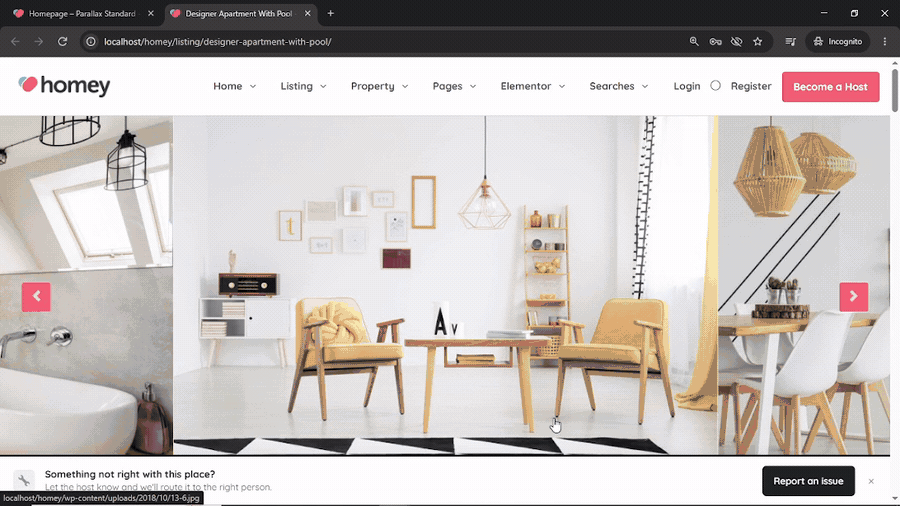

# Maintenance & Guest Request Triage Agent for WordPress

Let tenants and guests **report a problem straight from the listing page**, and let the plugin do the first-line triage for you. It reads the report, decides how urgent it is, drafts the message to send to a tradesperson, finds nearby vendors, and tracks the request until it's fixed.

Works automatically with **Houzez** (rental properties) and **Homey** (every listing). No n8n, Zapier or other workflow tool needed.

> Built by [WebPenter](https://github.com/webpenter).

## Demo

**Full walkthrough (1 min 41 s):**

https://github.com/user-attachments/assets/dcb84c8e-0a2c-40e2-b506-82d982f738d4

The demo runs on a Homey site: a guest reports an issue from the listing page, and the request lands in wp-admin with its urgency, trade, a drafted vendor message and a shortlist of nearby vendors.

## What it does

1. **Report form on the listing page**: a slim bar at the bottom of the page opens a form (name, contact, message, optional photo). Or place the form anywhere with `[wmta_report_form]`.
2. **Urgency triage**: every report is classified as *emergency*, *standard* or *cosmetic*, and tagged with the trade needed (plumber, electrician and so on).
   - With a free Groq API key the AI reads the message for a sharper result.
   - Without a key, a keyword list handles it (leak, flood, gas smell, no heat, no power, locked out, burst pipe...).
3. **Vendor message drafted for you**: a ready-to-send message describing the problem and the property.
4. **Nearby vendor shortlist**: with a Google Places key, it looks up the top 3 local vendors for that trade near the property's address, with rating, phone, website and map link.
5. **Request tracking**: each report gets a reference like `RT-AB12C` and a status you change from the admin list: *new, assigned, in progress, resolved*.
6. **Instant email alert**: you are notified of every request, with a 🚨 EMERGENCY subject line when it's urgent.
7. **Spam protection**: a hidden honeypot field and a minimum fill-in time stop most bots.

## Theme support

| Theme | Listing type | Where the form shows |
|---|---|---|
| **Houzez** | `property` | Only on listings with a rental status (rent, lease or let) |
| **Homey** | `listing` | On every listing (all are rentals) |

For Houzez, change the words that count as "rental" with the `wmta_houzez_rent_keywords` filter.

## Requirements

- WordPress 5.8+ and PHP 7.4+
- Houzez or Homey
- Optional: a free [Groq API key](https://console.groq.com/keys) for AI triage
- Optional: a Google Cloud API key with **Places API (New)** enabled, for the vendor shortlist

## Setup

1. Click **Code → Download ZIP**.
2. Put `wmta-maintenance-triage-agent.php` in a folder called `wmta-maintenance-triage-agent` and zip that folder.
3. In WordPress go to **Plugins → Add New → Upload Plugin**, upload and **Activate**.
4. Go to **Maintenance Requests → Settings** and fill in:

| Setting | What it does |
|---|---|
| Groq API key (optional) | Turns on AI urgency classification and vendor-message drafting |
| Groq model | Model used when a key is set (default `openai/gpt-oss-20b`) |
| Notification email | Where new-request alerts go (defaults to the site admin email) |
| Vendor email | Pre-fills the "send to vendor" email link |
| Accent color | Colour of the report bar and button |
| Google Places API key (optional) | Turns on the nearby-vendor shortlist |

5. Open a rental listing. The report bar appears at the bottom of the page.

Requests appear under **Maintenance Requests** in wp-admin, with urgency, trade, photo and status. Open one to see the drafted vendor message and the vendor shortlist.

## Notes

- If an API key is missing or a service is down, the plugin falls back to keyword triage and still saves the request.
- Local development sites (Laragon, localhost) often can't send email because of an invalid "From" address. The plugin works around this automatically.
- Treat Groq and Google keys as secrets and restrict the Google key to the Places API.

## License

MIT. See [LICENSE](LICENSE).
